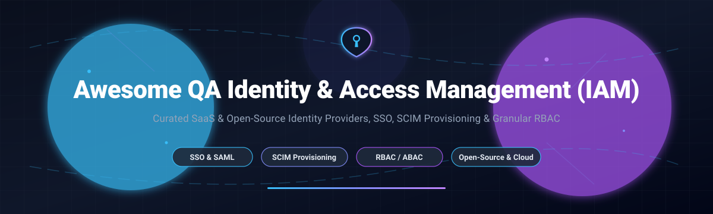

  

# 🔐 Awesome QA Identity & Access Management (IAM)

  
  
  
  
  
  

> 🛡️ **A curated list of top Identity and Access Management (IAM) platforms for QA and engineering teams** — covering enterprise cloud identity providers (IdPs), Single Sign-On (SSO), automated SCIM 2.0 user lifecycle provisioning, role-based access control (RBAC), fine-grained authorization, and high-performance open-source self-hosted alternatives for test lab security and compliance.
>
> 🌟 **Star this repository if you find it helpful!** 🌟

---

## 📋 Table of Contents

- [🌐 Sector Overview & Market Dynamics](#-sector-overview--market-dynamics)
- [🟦 SaaS / Hosted Platforms](#-saas--hosted-platforms)
- [🟩 Open-Source Software](#-open-source-software)
  - [1. 🗝️ Keycloak](#1-️-keycloak)
  - [2. 🛡️ Authelia](#2-️-authelia)
  - [3. 🔌 Authentik](#3--authentik)
  - [4. 🌊 Ory Hydra](#4--ory-hydra)
  - [5. ⚡ Zitadel](#5--zitadel)
  - [6. 🚀 SuperTokens](#6--supertokens)
  - [7. 🤖 Casdoor](#7--casdoor)
  - [8. 👤 Ory Kratos](#8-️-ory-kratos)
  - [9. 🏛️ Apereo CAS](#9-️-apereo-cas)
  - [10. 🌉 Dex IdP](#10--dex-idp)
  - [11. 🛡️ Ory Oathkeeper](#11-️-ory-oathkeeper)
  - [12. 🔓 OpenAM](#12--openam)
  - [13. 🌐 Evolveum midPoint](#13--evolveum-midpoint)
  - [14. 🔄 Apache Syncope](#14--apache-syncope)
  - [15. 🎓 Shibboleth Consortium](#15--shibboleth-consortium)
- [📊 Comparison at a Glance](#-comparison-at-a-glance)
- [🤝 Contributing](#-contributing)
- [💖 Support](#-support)
- [📈 Star History](#-star-history)
- [📄 License](#-license)

---

## 🌐 Sector Overview & Market Dynamics

The global Identity and Access Management (IAM) market was valued at approximately **$18.5 billion** and is projected to expand beyond **$41 billion by 2030** (advancing at a compound annual growth rate of ~13.5% to 15.2%). The sector is **moderately concentrated yet highly segmented**: hyper-scale enterprise infrastructure providers (such as Microsoft Entra ID and Okta) dominate foundational workforce identity and directory federation, while modern Zero-Trust, API-first identity, AI-native access control, and specialized QA test infrastructure environments remain vibrant, fragmented territories championed by specialized agile SaaS platforms and modular open-source solutions.

---

## 🟦 SaaS / Hosted Platforms

Commercial, cloud-hosted Identity and Access Management platforms sorted by vendor scale (market capitalization / valuation descending).

| Product | Parent Company / Vendor | Company Valuation / Market Cap | Pricing (Starting Paid Tier) | Free Tier Limit | Highlights & Best For |
|---|---|---|---|---|---|
| **🪟 Microsoft Entra ID** | Microsoft Corp. (NASDAQ: MSFT) | ~$3.1 Trillion Market Cap | **$6.00/user/month** (Entra ID P1 starting tier; P2 at $9.00/user/month) | **50,000 MAUs free** on Entra ID Free (includes core directory, SSO, basic MFA, and self-service password reset) | 🏢 Seamless Microsoft 365 / Azure integration, privileged identity management (PIM), conditional access policies, and enterprise compliance. |
| **🔐 Okta** | Okta, Inc. (NASDAQ: OKTA) | ~$15.8 Billion Market Cap | **$2.00/user/month** (Single Sign-On starting tier; Adaptive MFA at $3.00/user/month; $1,500/year platform annual minimum) | **30-day full-featured free trial**; Developer Edition offers **up to 7,500 MAUs free forever** | 🌐 Industry-leading vendor-neutral enterprise identity, 7,000+ pre-built SaaS app integrations, universal directory, and robust QA lifecycle provisioning. |
| **🛡️ CyberArk Identity** | CyberArk Software Ltd. (NASDAQ: CYBR) | ~$13.5 Billion Market Cap | **$2.00/user/month** (Single Sign-On basic tier; Adaptive MFA at $4.00/user/month) | **30-day free trial** with access for up to 100 users and full enterprise administrative capabilities | 🔒 Privileged access management (PAM) integration, dynamic attribute-driven role assignment, and robust context-aware security. |
| **☁️ JumpCloud** | JumpCloud Inc. (Private) | ~$2.6 Billion Valuation | **$9.00/user/month** (Core Directory starting package; Platform package at $17.00/user/month) | **Free forever plan for up to 10 users and 10 devices** (includes full directory, SSO, MFA, and device management) | 💻 Cross-platform cloud directory replacing legacy on-prem Active Directory, managing macOS, Windows, Linux, and web applications. |
| **⚡ BrowserStack IAM** | BrowserStack Inc. (Private) | ~$4.0 Billion Valuation | **$29.00/user/month** (Starting tier for automated testing suites with integrated enterprise IAM features) | **14-day free trial** with automated test runner minutes and administrative user management | 🧪 QA-native identity management with SAML 2.0 SSO, automated SCIM 2.0 user synchronization, and granular test suite RBAC. |
| **🛡️ OneLogin** | One Identity LLC / Quest Software (Private) | ~$3.5 Billion Valuation | **$2.00/user/month** (Starting basic SSO plan; Advanced bundle with SmartFactor MFA at $4.00/user/month) | **30-day free trial** with full enterprise single sign-on and directory synchronization features | 🎯 App-centric identity mapping, automated rule-based role allocation, and seamless directory connectors. |
| **🔑 Auth0 by Okta** | Okta, Inc. (NASDAQ: OKTA) | ~$15.8 Billion Parent Market Cap | **$35.00/month** (B2C Essentials starting tier for up to 1,000 MAUs) | **Free forever plan for up to 7,500 active users** with unlimited logins and social identity providers | 🛠️ Developer-first identity, fine-grained API scope RBAC, customized Actions/extensibility hooks, and fast QA mock environment setup. |
| **🌐 Ping Identity** | Thoma Bravo / Ping-ForgeRock (Private) | ~$2.8 Billion Acquisition Valuation | **$3.00/user/month** (PingOne Workforce starting tier with 5,000-user minimum; PingOne Customer starts at $35,000/year) | **30-day free trial** of PingOne Cloud Platform with complete authentication and verification modules | 🤖 AI-driven contextual risk protection, hybrid enterprise identity fabric, and high-assurance multi-cloud federation. |

---

## 🟩 Open-Source Software

Self-hosted, community-driven Identity and Access Management platforms, single sign-on servers, and identity governance systems sorted by GitHub stargazers count descending.

### 1. 🗝️ Keycloak

* **Repository:** [keycloak/keycloak](https://github.com/keycloak/keycloak)
* **Stack:** Java (Quarkus) | **License:** Apache-2.0
* **Overview:** The industry gold standard in open-source identity and access management maintained under Red Hat.
* **Key Features:** Full OAuth 2.0, OpenID Connect (OIDC), SAML 2.0, LDAP/Active Directory user federation, and native **SCIM 2.0 server** (version 26.8+). Fine-grained authorization services allow defining resources, scopes, and policies.
* **Best for:** QA engineering organizations seeking a battle-tested, enterprise-grade IAM backbone with LDAP integration and automated test user provisioning.

---

### 2. 🛡️ Authelia

* **Repository:** [authelia/authelia](https://github.com/authelia/authelia)
* **Stack:** Go / React | **License:** Apache-2.0
* **Overview:** High-performance, lightweight authentication and authorization companion server designed for reverse proxies.
* **Key Features:** Multi-factor authentication portal (TOTP, WebAuthn, FIDO2, Duo), OpenID Connect provider (OIDC 1.0), forward-auth integration for Traefik, NGINX, Envoy, Caddy, and HAProxy.
* **Best for:** Securing internal QA test environments, staging dashboards, and preview apps with robust multi-factor authentication without overhead.

---

### 3. 🔌 Authentik

* **Repository:** [goauthentik/authentik](https://github.com/goauthentik/authentik)
* **Stack:** Python / Go | **License:** MIT Core / Commercial Enterprise
* **Overview:** Highly flexible, all-in-one identity provider designed for adaptability and custom sign-in flows.
* **Key Features:** Visual flow and stage engine with Python policy expressions, OAuth 2.0/OIDC, SAML 2.0, LDAP and RADIUS outposts, built-in reverse proxy provider, and native **SCIM synchronization source**.
* **Best for:** Teams requiring customized authentication lifecycles and seamless proxy-level access gatekeeping for testing tools.

---

### 4. 🌊 Ory Hydra

* **Repository:** [ory/hydra](https://github.com/ory/hydra)
* **Stack:** Go | **License:** Apache-2.0
* **Overview:** Hardened, internet-scale, headless OpenID Certified™ OpenID Connect and OAuth 2.1 authorization server.
* **Key Features:** Pure headless architecture, zero UI assumptions (bring your own login and consent screens), low memory footprint, extreme throughput, and full standard compliance.
* **Best for:** QA teams building and verifying OAuth 2.1 compliance across API services and decoupled frontends.

---

### 5. ⚡ Zitadel

* **Repository:** [zitadel/zitadel](https://github.com/zitadel/zitadel)
* **Stack:** Go / TypeScript | **License:** AGPL-3.0
* **Overview:** Modern, cloud-native identity infrastructure tailored for multi-tenancy and developer agility.
* **Key Features:** Event-sourced architecture, native multi-tenant organizational hierarchy, passwordless (FIDO2/WebAuthn), fine-grained roles, and **SCIM 2.0 server** preview.
* **Best for:** Organizations testing multi-tenant SaaS products and isolated team environments with modern REST/gRPC APIs.

---

### 6. 🚀 SuperTokens

* **Repository:** [supertokens/supertokens-core](https://github.com/supertokens/supertokens-core)
* **Stack:** Java / Node.js / Python / Go | **License:** Apache-2.0 / Commercial Core
* **Overview:** Modular, developer-friendly open-source alternative to Auth0, AWS Cognito, and Firebase Auth.
* **Key Features:** Session management with anti-CSRF tokens, passwordless magic links, social login, multi-factor authentication, and granular RBAC.
* **Best for:** Software testing teams creating end-to-end integration test suites for consumer-facing authentication workflows.

---

### 7. 🤖 Casdoor

* **Repository:** [casdoor/casdoor](https://github.com/casdoor/casdoor)
* **Stack:** Go / React | **License:** Apache-2.0
* **Overview:** AI-native IAM and SSO platform featuring integrated **Model Context Protocol (MCP)** server capabilities.
* **Key Features:** OAuth 2.0/2.1 for MCP, SAML 2.0, CAS, LDAP, RADIUS, **SCIM 2.0 server** for receiving directories from Okta or Entra ID, webhooks, and 70+ built-in social/enterprise connectors.
* **Best for:** QA and testing organizations integrating autonomous AI agents and modern automated test frameworks into identity workflows.

---

### 8. 👤 Ory Kratos

* **Repository:** [ory/kratos](https://github.com/ory/kratos)
* **Stack:** Go | **License:** Apache-2.0
* **Overview:** Cloud-native headless identity, user management, and credential store implementing the IETF specifications.
* **Key Features:** Headless login, registration, recovery, verification, MFA (TOTP, WebAuthn), and self-service account management completely decoupled from user interfaces.
* **Best for:** Building fully automated API-driven regression test fixtures for user onboarding and credential lifecycles.

---

### 9. 🏛️ Apereo CAS

* **Repository:** [apereo/cas](https://github.com/apereo/cas)
* **Stack:** Java (Spring Boot) | **License:** Apache-2.0
* **Overview:** Historic, enterprise single sign-on engine trusted widely across academia, government, and enterprises.
* **Key Features:** Central Authentication Service (CAS) protocol, SAML 1.1/2.0, WS-Federation, OAuth 2.0/OIDC, multifactor authentication (Duo, FIDO2, Google Authenticator), and extensive directory clustering.
* **Best for:** Institutional test labs validating federated enterprise single sign-on against legacy and modern identity standards.

---

### 10. 🌉 Dex IdP

* **Repository:** [dexidp/dex](https://github.com/dexidp/dex)
* **Stack:** Go | **License:** Apache-2.0
* **Overview:** OpenID Connect (OIDC) identity broker and OAuth 2.0 provider with pluggable directory connectors.
* **Key Features:** Acts as an authentication proxy delegating to LDAP, SAML, GitHub, Google, GitLab, or Microsoft, standardizing authorization to upstream applications.
* **Best for:** QA test infrastructures, Kubernetes clusters, and cloud-native services needing a uniform OIDC authentication bridge.

---

### 11. 🛡️ Ory Oathkeeper

* **Repository:** [ory/oathkeeper](https://github.com/ory/oathkeeper)
* **Stack:** Go | **License:** Apache-2.0
* **Overview:** Cloud-native Identity & Access Proxy (IAP) and Access Controller implementing Zero-Trust architecture.
* **Key Features:** Reverse proxy authenticating and authorizing incoming HTTP requests according to defined access rules before forwarding to target upstream microservices.
* **Best for:** Verifying Zero-Trust network access and role policies in QA microservice environments.

---

### 12. 🔓 OpenAM

* **Repository:** [OpenIdentityPlatform/OpenAM](https://github.com/OpenIdentityPlatform/OpenAM)
* **Stack:** Java | **License:** CDDL-1.0
* **Overview:** Community-maintained continuation of Sun OpenSSO / ForgeRock OpenAM providing robust access management.
* **Key Features:** Web access management, adaptive risk-based authentication, SAML 2.0, OAuth 2.0/OIDC federation, dynamic policy evaluation, and audit logging.
* **Best for:** Enterprises maintaining and testing legacy ForgeRock/OpenSSO workflows on an open-source baseline.

---

### 13. 🌐 Evolveum midPoint

* **Repository:** [Evolveum/midpoint](https://github.com/Evolveum/midpoint)
* **Stack:** Java | **License:** EUPL-1.2
* **Overview:** Comprehensive open-source Identity Governance and Administration (IGA) platform for complete lifecycle automation.
* **Key Features:** Automated provisioning and de-provisioning, role mining, policy-based approvals, segregation of duties (SoD) enforcement, and compliance audit campaigns.
* **Best for:** Validating compliance governance, role certifications, and automated user synchronization in QA and audit environments.

---

### 14. 🔄 Apache Syncope

* **Repository:** [apache/syncope](https://github.com/apache/syncope)
* **Stack:** Java | **License:** Apache-2.0
* **Overview:** Standards-based open-source digital identity management and identity governance platform governed by the Apache Software Foundation.
* **Key Features:** Automated user provisioning, granular RBAC, delegated administration, LDAP/Active Directory/database connectors, SAML 2.0, OIDC, and SCIM 2.0 support.
* **Best for:** Testing automated identity lifecycle provisioning and governance workflows with Apache-governed connectors.

---

### 15. 🎓 Shibboleth Consortium

* **Repository:** [shibboleth](https://github.com/shibboleth)
* **Stack:** Java / C++ | **License:** Apache-2.0 / Shibboleth License
* **Overview:** The federated single sign-on standard connecting higher education, research networks, and public institutions globally.
* **Key Features:** SAML-based identity provider (IdP) and service provider (SP) federated authentication, centralized auditing, and trust federation across international academic consortiums.
* **Best for:** Higher education QA teams verifying cross-institutional federated Single Sign-On and research access protocols.

---

## 📊 Comparison at a Glance

| Software | License | Primary Stack | Architecture | SSO Protocols | SCIM 2.0 | Granular RBAC | Self-Hosted |
|---|---|---|---|:---:|:---:|:---:|:---:|
| **🪟 Microsoft Entra ID** | Proprietary | Cloud Native | SaaS Directory | SAML / OIDC / WS-Fed | ✅ Server & Client | ✅ Custom & Built-in | ❌ |
| **🔐 Okta** | Proprietary | Cloud Native | SaaS Identity Cloud | SAML / OIDC / OAuth2 | ✅ Server & Client | ✅ Scope-based | ❌ |
| **🛡️ CyberArk Identity** | Proprietary | Cloud Native | SaaS Identity Fabric | SAML / OIDC / WS-Fed | ✅ Automated Sync | ✅ Dynamic Attributes | ❌ |
| **☁️ JumpCloud** | Proprietary | Cloud Native | Cloud Directory | SAML / OIDC / RADIUS | ✅ SCIM 2.0 Connector | ✅ Custom Roles | ❌ |
| **⚡ BrowserStack IAM** | Proprietary | Cloud Native | QA-Native SaaS | SAML / Google OAuth | ✅ SCIM 2.0 Ingest | ✅ Product & Team RBAC | ❌ |
| **🛡️ OneLogin** | Proprietary | Cloud Native | SaaS Identity Suite | SAML / OIDC / CAS | ✅ SCIM Directory | ✅ App Mappings | ❌ |
| **🔑 Auth0** | Proprietary | Cloud Native | Developer SaaS | SAML / OIDC / OAuth2 | ✅ SCIM Enterprise | ✅ API Scopes | ❌ |
| **🌐 Ping Identity** | Proprietary | Cloud / Hybrid | Enterprise Fabric | SAML / OIDC / WS-Trust | ✅ Automated Sync | ✅ Contextual AI Roles | ⚠️ (Hybrid) |
| **🗝️ Keycloak** | Apache-2.0 | Java (Quarkus) | Full IAM Platform | SAML / OIDC / OAuth2 | ✅ SCIM 2.0 (v26.8+) | ✅ Realm & Client RBAC | ✅ |
| **🛡️ Authelia** | Apache-2.0 | Go / React | Reverse Proxy Auth | OIDC / Forward-Auth | ❌ (LDAP Sync) | ✅ Rule-based ACL | ✅ |
| **🔌 Authentik** | MIT / Comm. | Python / Go | Modular IAM & Proxy | SAML / OIDC / Proxy | ✅ SCIM Source | ✅ Flow Policies | ✅ |
| **🌊 Ory Hydra** | Apache-2.0 | Go | Headless OAuth/OIDC | OAuth 2.1 / OIDC | ❌ (Pair w/ Kratos) | ✅ Scope-based | ✅ |
| **⚡ Zitadel** | AGPL-3.0 | Go / TypeScript | Multi-Tenant Cloud-Native | SAML / OIDC / OAuth2 | ✅ SCIM 2.0 Preview | ✅ Org & Project RBAC | ✅ |
| **🚀 SuperTokens** | Apache-2.0 | Java / Multi-SDK | Modular Developer Auth | Session / OAuth2 | ❌ | ✅ Role & Permissions | ✅ |
| **🤖 Casdoor** | Apache-2.0 | Go / React | AI-Native IAM & MCP | SAML / OIDC / CAS / MCP | ✅ SCIM 2.0 Server | ✅ Resource Roles | ✅ |
| **👤 Ory Kratos** | Apache-2.0 | Go | Headless User Store | OIDC / Social Identity | ❌ | ❌ (Pair w/ Keto) | ✅ |
| **🏛️ Apereo CAS** | Apache-2.0 | Java (Spring) | Enterprise SSO Engine | SAML / CAS / OIDC | ✅ Provisioning Sync | ✅ Attribute Entitlements | ✅ |
| **🌉 Dex IdP** | Apache-2.0 | Go | Identity Broker | OIDC Gateway | ❌ | ✅ Group Pass-through | ✅ |
| **🛡️ Ory Oathkeeper** | Apache-2.0 | Go | Identity & Access Proxy | Zero-Trust Proxy Gate | ❌ | ✅ Access Rule Engine | ✅ |
| **🔓 OpenAM** | CDDL-1.0 | Java | Access Management Suite | SAML / OIDC / OAuth2 | ✅ Connector-based | ✅ Policy Model | ✅ |
| **🌐 Evolveum midPoint** | EUPL-1.2 | Java | Full IGA Governance | SAML / OIDC Connectors | ✅ SCIM Connector | ✅ Role Mining & SoD | ✅ |
| **🔄 Apache Syncope** | Apache-2.0 | Java | Standards-based IGA | SAML / OIDC / SCIM | ✅ SCIM 2.0 Complete | ✅ Delegated RBAC | ✅ |
| **🎓 Shibboleth** | Apache-2.0 | Java / C++ | Federated Academic SSO | SAML 2.0 / Shibboleth | ❌ | ✅ Federation Trust | ✅ |

---

## 🤝 Contributing

Contributions, additions, and suggestions are warmly encouraged! To propose a new open-source or enterprise QA Identity or Access Management tool:

1. 🍴 Fork this repository.
2. 🔍 Verify that the project is actively maintained (commits or releases within the last 12 months) and relevant to identity, authentication, access control, or test provisioning.
3. 📝 Add the project with its GitHub repository link, Stars_Badge, technology stack, license, and standout capabilities.
4. 🔢 Ensure the open-source list remains sorted by GitHub stargazers count descending.
5. 🚀 Open a Pull Request with a clear description of why the tool is a valuable addition.

---

## 💖 Support

Thank you for exploring and using this curated guide to QA Identity & Access Management platforms! 🙏

If you found this resource helpful, please consider supporting the project:
* ⭐ **Star** this repository on GitHub to help others discover it.
* 🍴 **Fork** and contribute new tools, updates, or fixes.
* 📢 **Share** this list with fellow QA engineers, DevOps specialists, and security practitioners.
* ☕ **Buy a Coffee / Sponsor**: Support ongoing maintenance and curation on the [GitHub Sponsor Dashboard](https://github.com/sponsors/ishandutta2007).

---

## 📈 Star History

---

## 📄 License

This repository and curated list are released under the [Creative Commons Zero v1.0 Universal](LICENSE) (CC0 1.0) Public Domain Dedication. All listed software platforms, logos, and trademarks belong to their respective copyright holders.
